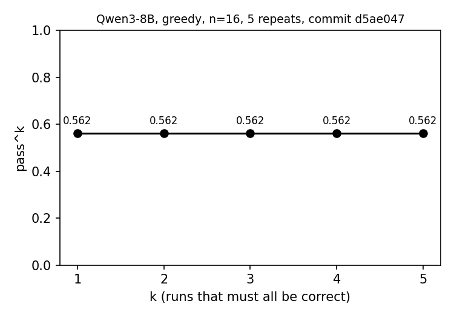

# Progress report: Qwen3-8B eval runs 2, 3 and 4

Date: 2026-10-12. Question set: the challenge's public Phase 1 validator, 16
questions with reference answers, 13 distinct variants. Model: Qwen3-8B,
bfloat16, greedy decoding, on one A10G. Per-question tool traces were
recorded for both runs; every claim below is read from the trace, not from
the score.

| Run | Date | Commit | Score | Citations grounded in their source text |
|---|---|---|---|---|
| Baseline | 2026-09-25 | 4209f42 | 5/16 | not measured (no trace) |
| Run 2 | 2026-10-07 | 1b01179 | 3/16 | 0 of 43 |
| Run 3 | 2026-10-11 | e44bc4c | 8/16 | 22 of 33 |
| Run 4 | 2026-10-12 | b91fa95 | 7/16 | 15 of 26 |
| Run 5, five repeats | 2026-10-12 | d5ae047 | 9/16 in every repeat | 32 of 38 in every repeat |

Correct answers that are also supported by a quoted record (the
`correct_supported` label), which is the number that matters for a clinical
answer:

| Run | Correct | Correct and supported | Correct but unsupported |
|---|---|---|---|
| Baseline | 5 | not measured (no trace) | not measured |
| Run 2 | 3 | 0 | 3 (00003, 00005, 00010) |
| Run 3 | 8 | 7 (00003, 00005, 00007, 00009, 00012, 00013, 00015) | 1 (00010) |
| Run 4 | 7 | 6 (00003, 00009, 00010, 00013, 00014, 00015) | 1 (00005: both citations quoted the right facts under the wrong links) |
| Run 5 (each of 5 repeats) | 9 | 9 (00003, 00004, 00005, 00007, 00008, 00009, 00010, 00013, 00015) | 0 |

Per category, run 2 to run 3: Established_Targeted 2/7 to 3/7;
Established_Supportive 0/1 to 0/1; Clinical_Trials 1/3 to 2/3;
Drug_Development_and_Repurposing 0/1 to 1/1; Variant_Assessment 0/4 to 2/4.

Caveat on run 3: it started before commit 2fe9701, so the OMIM adapter was
broken (a missing import since the retry commit, read as "no entries"); no
question in run 3 called OMIM, so no answer was affected. Caveat on run 2:
the PubMed tool schema's example query at that commit stated the reference
answer to AITX-00001 (fixed in dbd076a); the model still answered that
question wrong.

## 1. Error taxonomy

One primary label per question, read in pipeline order so the earliest
failure wins, plus flags. Definitions are in the local `error_taxonomy.md`.

| Label | Meaning |
|---|---|
| `correct_supported` | correct, and a cited source's returned text states the fact |
| `correct_unsupported` | correct, but no retrieved text supports it |
| `wrong_tool` | no suitable tool was called |
| `wrong_arguments` | a suitable tool was called with arguments that could not find the answer |
| `retrieval_nothing` | a sound call returned nothing or an error |
| `retrieval_insufficient` | the right record came back without the needed fact |
| `retrieval_wrong_entity` | records came back for a different variant, gene, drug or condition |
| `extraction_wrong` | the answer was in a result and the model misread it |
| `synthesis_wrong` | the pieces were retrieved and combined into the wrong conclusion |
| `format_mismatch` | the right content in a form exact match rejects |
| `reference_questionable` | the answer is defensible against live sources; the key may be stale |

### Run 2 (3/16)

| Patient | Answer | Primary label | Cause in the trace |
|---|---|---|---|
| 00001 | None | retrieval_wrong_entity | forced GeneReviews call built from the phrase "Progressive muscle weakness" fetched an RFC1 chapter |
| 00002 | None | extraction_wrong | VEP said stop_gained in exon 74; model wrote "not a premature stop" |
| 00003 | None (correct) | correct_unsupported | ClinVar records said "Not provided"; citations invented |
| 00004 | None | retrieval_insufficient | GeneReviews passage cut before pyridoxine |
| 00005 | No (correct) | correct_unsupported | citation gave a reason not in the source |
| 00006 | lumasiran, nedosiran | synthesis_wrong | no drug in any result; age limit missed |
| 00007 | Not available | wrong_tool | OMIM and ClinVar called for a GeneReviews fact |
| 00008 | Aspirin, Ibuprofen | retrieval_wrong_entity | passage taken from the osteogenesis imperfecta chapter |
| 00009 | NCT05678901 | wrong_arguments | status filter with spaces rejected by the API; trial number fabricated |
| 00010 | No (correct) | correct_unsupported | search found nothing |
| 00011 | 4 NCT IDs | reference_questionable | recruiting KCNT1 trials postdate the key |
| 00012 | Memantine | retrieval_insufficient | PubMed titles without abstracts |
| 00013 | 3 | retrieval_insufficient | VEP gave the exon index, not its length |
| 00014 | 3 | retrieval_insufficient | same |
| 00015 | Yes | synthesis_wrong | last-exon rule not applied |
| 00016 | CSRD | retrieval_nothing | UniProt timed out at 15 s; answer from memory |

Every one of the 43 citations in run 2 was unsupported by its source text:
the justification step was given URLs, not the retrieved text.

### Run 3 (8/16)

| Patient | Answer | Primary label | Cause in the trace |
|---|---|---|---|
| 00001 | None | wrong_tool | asked GeneReviews for the gene with no chapter chosen, then ClinVar; never fetched the Dystrophinopathies chapter or called VEP; reasoned exons wrongly from memory |
| 00002 | None | extraction_wrong | as run 2 |
| 00003 | None (correct) | correct_supported | N1C guideline text quoted |
| 00004 | None | synthesis_wrong | pyridoxine sentence retrieved and quoted; model judged the variant's responsiveness unknown (Gly170Arg is the classic responsive variant) |
| 00005 | No (correct) | correct_supported | ClinVar record quoted |
| 00006 | lumasiran, nedosiran | synthesis_wrong | both drugs retrieved; the age limit is on the FDA label, which the model considered checking and did not |
| 00007 | 18 months (correct) | correct_supported | AADC chapter management text |
| 00008 | Ascorbic acid, DDAVP | format_mismatch | right pair; DDAVP is desmopressin's trade abbreviation |
| 00009 | NCT05402384 (correct) | correct_supported | trial search with the normalised filter |
| 00010 | No (correct) | correct_unsupported | the trial search put the whole symptom phrase in the condition field and found nothing; the only citation quotes the adapter's own "No clinical trials found" line, which the quote check accepted although it does not bear on eligibility for a trial that exists; the haemoglobin exclusion was never retrieved |
| 00011 | NCT07227857 | reference_questionable | as run 2 |
| 00012 | L-serine (correct) | correct_supported | five abstracts report L-serine for loss-of-function variants |
| 00013 | 66 (correct) | correct_supported | exon coding length from the Ensembl exon map |
| 00014 | 10.0 | format_mismatch | the same fact as a percentage; the key uses the fraction 0.1 |
| 00015 | No (correct) | correct_supported | VEP "exon 37 of 37"; model applied the last-exon rule |
| 00016 | TBD | synthesis_wrong | UniProt places 1243 outside its Ras-GAP domain (1251-1482) where the key's GRD spans 1198-1549; model then read "TBD" as "to be determined" |

Flag counts in run 3: `citation_unsupported` 11 of 33 citations (6 of them
the GeneReviews chapter-list links, see next steps); `evidence_reminder` 1;
`fabricated_identifier` 0; `empty_result_notice` 0.

## 2. What was changed between the runs

All on `main`, each with a test that fails without it, recorded replies as
fixtures, and a live check on the eval set.

| Commit | Change | Taxonomy target |
|---|---|---|
| 9413dd5 | Ensembl: exon coding length, codon count and frame from the transcript's exon map | retrieval_insufficient (00013, 00014) |
| 5297fe8 | ClinVar: read `germline_classification`, which replaced the field the adapter read | correct_unsupported, "Not provided" on every record |
| 198296a, 17fd8a1, f13821f | New adapters: PHAROS, N1C ASO guidelines, ClinGen dosage | Phase 3 sources; N1C text supported 00003 |
| dbd076a | PubMed schema example no longer states an eval answer | leak |
| 5659091 | GeneReviews: chapters from NCBI's index files; model chooses the chapter; full management section from the structured abstract | retrieval_wrong_entity, retrieval_insufficient (00001, 00004, 00006, 00008) |
| 3ce8b72, 0020295 | Shared NCBI retry on 429, 5xx and timeouts | retrieval_nothing |
| ea06c18, 2ead5a1 | Code no longer composes queries: an evidence reminder and an empty-result notice replace the forced call and auto-chain | retrieval_wrong_entity from code-built queries |
| fa5eb1a | PubMed returns abstracts | retrieval_insufficient (00012) |
| 856b167 | ClinicalTrials.gov status filter normalised and validated | wrong_arguments (00009) |
| bd05f7b | Identifiers in the answer must occur in a tool result | fabricated identifiers (00009) |
| e44bc4c | Each citation quotes its own retrieved text; the quote is verified in code | citation_unsupported, all 43 in run 2 |
| 2fe9701 | OMIM adapter import fix and logged exceptions | not in run 3 |

## 3. What improved, and why

Five questions flipped from wrong to correct, each to a named change:

- 00007: the GeneReviews management text, in full, states the gene-therapy age.
- 00009: the status filter is accepted; the real trial is returned; no identifier invented.
- 00012: abstracts, not titles, state the drug for loss-of-function variants.
- 00013: the exon's coding length is computed and shown.
- 00015: VEP's exon index reached the model and it applied the rule itself.

Citations grounded in their source text went from 0 of 43 to 22 of 33, one
of which (00010) quotes an adapter's own "nothing found" line rather than a
record, so 21 of 33 cite a record. Fabricated identifiers went from 1 to 0.
Two of the three "correct for the wrong reason" answers of run 2 (00003,
00005) are now correct with a quoted record; 00010 is still correct without
support. No code-built query ran.

Two further questions have the right content and fail only exact match:
00008 (DDAVP for desmopressin) and 00014 (10.0 percent for 0.1).

## 4. What did not improve, and why

- 00001, 00002: the facts that decide exon skipping and readthrough were
  either not fetched (00001: VEP not called, chapter not fetched) or
  fetched and misread (00002). The model's routing and reading, not the
  tools. Category-3 reasoning failures are left to the planned move to a
  32B-class model; decided 2026-10-11.
- 00004: retrieved and quoted the right sentence, then answered None out
  of caution about the variant's responsiveness. Knowledge the model lacks.
- 00006: stopped one call short of the FDA label that carries the age limit.
- 00016: a genuine boundary disagreement between UniProt and the answer key,
  compounded by the model misreading an option name.
- 00011: the reference answer appears stale against live ClinicalTrials.gov.

Run 3 took 1,436 s of agent time for 16 questions (41 to 182 s each)
against 1,594 s for run 2, despite the justification step now reading up to
five source texts per question and Ensembl adding two requests per variant;
fewer wasted lookups and no code-built chained calls account for the
difference.

## 5. Next steps

1. The GeneReviews chapter list should return no evidence links; only a
   fetched chapter should be cited (6 of the 11 unsupported citations).
2. Add VEP to the Established_Targeted tool order, since exon-skipping and
   readthrough eligibility depend on consequence and frame (00001).
3. The justification sentence can contradict a verbatim quote (00016), and
   an adapter's own "nothing found" sentence passes as a quote (00010); the
   next evaluator layer checks the sentence against the quote and refuses
   adapter boilerplate as grounding.
4. Run the same 16 questions with Qwen3-32B in 8-bit on an L40S (g6e.xlarge)
   and with gpt-oss-20b in bfloat16 on the A10G, with the same traces, to
   separate model capability from tool coverage.
5. Remaining silent exception handlers in ClinVar and PharmGKB to log and
   surface errors, as OMIM now does.
6. Phase 3: build the report task on the five goals, goal 1 first.

## 6. Run 4 (2026-10-12, commit b91fa95): 7/16

Run 4 measured the seven model-independent fixes made after run 3 (exact
ClinVar lookup, list answers joined, brand names mapped via RxNorm, trial
eligibility text, shared retry, DailyMed label pages, logged handlers), the
two report follow-ups (chapter list uncited, VEP second for targeted
therapies), and the boilerplate rule. Per category: Established_Targeted
2/7, Established_Supportive 0/1, Clinical_Trials 2/3,
Drug_Development_and_Repurposing 0/1, Variant_Assessment 3/4. Agent time
1,675 s (33 to 259 s per question), against 1,436 s for run 3; the
per-source justification calls were not yet in.

### Run 4, every question

| Patient | Answer | Primary label | Cause in the trace |
|---|---|---|---|
| 00001 | None | synthesis_wrong | called GeneReviews (list, no chapter chosen), ClinVar (no record for the deletion, as it now reports) and VEP, which gave exons 52-63 out of frame by one; did not reason from that to exon 51 skipping |
| 00002 | None | extraction_wrong | VEP's premature stop in exon 74 again not connected to Ataluren |
| 00003 | None (correct) | correct_supported | VEP and ClinVar records quoted; one citation rejected |
| 00004 | lumasiran, nedosiran | synthesis_wrong | read the PH1 chapter, took the RNAi pair, ignored "small molecule" |
| 00005 | No (correct) | correct_unsupported | right facts retrieved, but both citations quoted a sentence under the other source's link, so the check rejected both |
| 00006 | lumasiran, nedosiran | synthesis_wrong | one line now; the age limit is on the FDA label, never fetched |
| 00007 | Not available | wrong_tool | went to ClinVar first and stopped; never opened the GeneReviews chapter that states 18 months (correct in run 3) |
| 00008 | No evidence was found | wrong_tool | the chapter list now returns no evidence links and the empty-result notice took that as a failed lookup, steering the model to OMIM (correct pair in run 3); a bug in 5b82d04 with 2ead5a1, fixed in 3f62adc |
| 00009 | NCT05402384 (correct) | correct_supported | trial search with the normalised filter |
| 00010 | No (correct) | correct_supported | fetched the trial by ID and reasoned from the haemoglobin exclusion (unsupported in run 3) |
| 00011 | NCT07227857 | reference_questionable | as before |
| 00012 | Memantine | synthesis_wrong | stopped at PHAROS, which lists memantine as an approved drug on the target without the loss- or gain-of-function distinction; never reached the abstracts (correct in run 3) |
| 00013 | 66 (correct) | correct_supported | exon coding length |
| 00014 | 0.1 (correct) | correct_supported | same Ensembl line as run 3; the model read "decimal" as the fraction this time |
| 00015 | No (correct) | correct_supported | last exon, as in run 3 |
| 00016 | TBD | synthesis_wrong | UniProt's Ras-GAP boundary at 1251 against the key's GRD at 1198; "TBD" read as "to be determined" |

Against run 3: 00014 and 00010 improved; 00007, 00008 and 00012 regressed;
the rest are unchanged in answer.

Grounded citations fell from 22 of 33 to 15 of 26. Seven of the eleven
rejections were the model attaching one source's sentence to another
source's link (the same trial summary under three trials in 00011; a
GeneReviews sentence under a ClinVar link in 00004 and 00005), which the
check rightly refuses; the rest were honest "not supported" on answers of
"not available" or "no evidence". The denominator also shrank because the
chapter list no longer adds links.

### What run 4 shows

1. **The model's first tool choice is brittle.** The tool set was the same
   as run 3; only descriptions and one ordering changed, yet with greedy
   decoding 00007 and 00012 took different first tools and lost. The habit
   underneath, stopping at the first plausible result, was present in run 3
   too (00001, 00004, 00006) and only became visible where the first choice
   changed.
2. **Each fix needs its interaction with the loop checked.** Removing the
   chapter list's evidence links was right on its own and wrong in
   combination with a notice that treats "no evidence" as "nothing found".
3. **Nine of sixteen questions now have the right fact in a retrieved
   record** (the seven supported-correct plus 00004 and 00006, which hold the
   right chapter text and fail on reasoning), against four in run 2.

### Fixed after run 4

- 3f62adc: the empty-result notice fires only when every result is an
  adapter's own "nothing found" reply; a menu such as the chapter list no
  longer triggers it.
- 06f0374: each citation is justified in its own model call showing only
  that source's text, so a quote cannot be attached to the wrong link.

### Next steps, revised

1. Measure prompt sensitivity directly: the same sixteen questions under a
   trivially reworded prompt, to put a number on the brittleness before the
   model comparison.
2. The model comparison on the L40S VM: Qwen3-32B in 8-bit and gpt-oss-20b in
   bfloat16, same traces.
3. A sampling ablation with Qwen3's recommended settings and a fixed seed,
   with the final answer taken by a separate greedy thinking-off call.
4. Run the March question set (sixteen different patients, no key) and read
   its traces for tool choice and grounding, as a check against tuning to the
   validator set.
5. Phase 3: the report task on the five goals, goal 1 first.

## 7. Run 5: five repeats of one configuration (2026-10-12, commit d5ae047)

The four changes after run 4 were in: the empty-result notice ignores a
menu reply (3f62adc), one source per justification call (06f0374), VEP run
for every variant in step 1 with its consequence in the variant block
(06518e0), and the prompt-variant flag, unused here (d5ae047). To measure
run-to-run variance, the same configuration ran five times in sequence with
nothing changed but the clock; pass^k over the five was computed with the
estimator C(c, j) / C(k, j) per question.

**Result: the five runs are identical.** Every question's tool calls, tool
result texts, and answer are byte-for-byte the same in all five; only
timing varies (1,685 to 1,994 s of agent time per run). pass^1 through
pass^5 are all 0.562, 9 of 16. Under greedy decoding with batch size one,
neither GPU arithmetic nor the live APIs introduced any variance over the
two and a half hours.

The curve was drawn from the five results files with
`uv run --with matplotlib python` and the `pass_k_curve` function in
scripts/pass_k.py; matplotlib is not a project dependency. The six first-tool changes between runs 3 and 4 were
therefore caused entirely by the prompt edits between those runs, not by
noise; the brittleness is to inputs, and it is deterministic.

| Patient | Answer | Label | Note |
|---|---|---|---|
| 00001 | None | synthesis_wrong | VEP's out-of-frame verdict in the prompt; still not reasoned to exon 51 |
| 00002 | None | extraction_wrong | as before |
| 00003 | None (correct) | correct_supported | |
| 00004 | pyridoxine (correct) | correct_supported | first time: with the consequence (missense) in the prompt, the chapter's "missense AGXT variants" sentence was applied |
| 00005 | No (correct) | correct_supported | citations now attached to their own sources |
| 00006 | lumasiran, nedosiran | synthesis_wrong | label never fetched |
| 00007 | 18 months (correct) | correct_supported | GeneReviews first again |
| 00008 | Ascorbic acid, Desmopressin (correct) | correct_supported | chapter chosen by phenotype; DDAVP mapped to desmopressin through RxNorm |
| 00009 | NCT05402384 (correct) | correct_supported | |
| 00010 | No (correct) | correct_supported | trial fetched by ID |
| 00011 | NCT07227857 | reference_questionable | |
| 00012 | Memantine | synthesis_wrong | PHAROS first, stopped there, in all five runs |
| 00013 | 66 (correct) | correct_supported | |
| 00014 | 10 | format_mismatch | the same line read as a percentage again (0.1 in run 4) |
| 00015 | No (correct) | correct_supported | |
| 00016 | TBD | synthesis_wrong | boundary disagreement |

Grounded citations: 32 of 38 in every repeat, against 15 of 26 in run 4; the
per-source justification call removed the cross-attached quotes.

### What run 5 shows

1. The system is deterministic at this commit; repeated runs add no
   information, so the budget for reliability measurement should go to
   sampling or to prompt variants, not to repeats of greedy runs.
2. Nine of sixteen correct and supported is the best result so far, and two
   of the gains (00004, 00008) came from giving the model the consequence
   and the chosen chapter before it reasons, which is the step-1 pipeline.
3. The remaining wrong answers are the model's: three reasoning failures
   (00001, 00002, 00012), two condition misses (00006, 00014), one
   source-boundary case (00016), and one stale key (00011).

